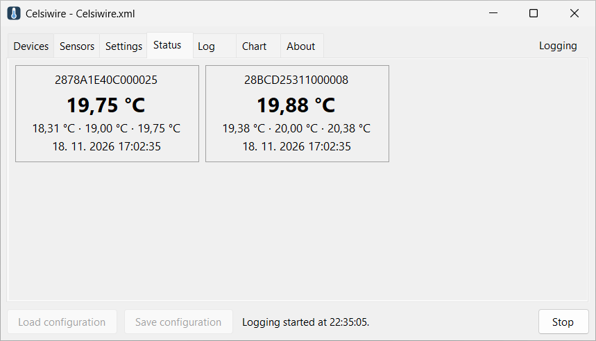
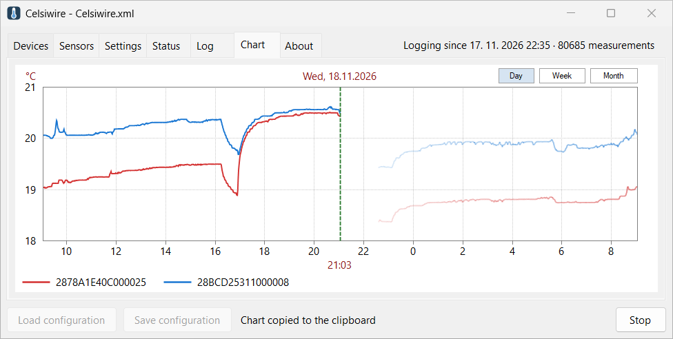

# Celsiwire

Temperature logger for Windows that reads 1-Wire **DS18B20** sensors through **DS9097E** or **DS9097U** serial adapters.
It shows live values, records them to CSV files, and raises alarms when a sensor leaves its limits.

Source code: <https://github.com/usbtemp/celsiwire>

Sponsored by [usbtemp.com](https://usbtemp.com)

## Features

- Several sensors on several COM ports. The adapter type is detected automatically.
- Measurement interval from 1 second to 10 minutes (default 5 seconds), plus custom values.
- CSV files with one column per sensor. A new file is started after a set number of records or every day.
- Status tab showing each sensor's value with its min, average and max since logging started.
- Chart tab with the temperatures of the last day, week or month, one colour per sensor.
- Low and high alarm limits per sensor, with hysteresis, an optional sound and a tray notification.
- Alarm when a sensor has not been read for 1 minute during logging.
- A USB adapter that is unplugged during logging is picked up again when it comes back, even on a different COM port. The same applies to an adapter that is missing when logging starts: its sensors keep their columns in the file and are read as soon as it is plugged in.
- The serial port list refreshes by itself when a USB adapter is plugged in or removed (when not logging).
- Calibration offset per sensor (±5 °C), applied to displayed, logged and alarm values.
- Sensor names, so files and the status tab show names instead of ROM codes.
- Tray icon: blue when idle, green while logging, red during an alarm. Its tooltip lists current values.
- Logging indicator at the right end of the tab strip: a blinking green dot (red during an alarm) with the start time and
  the number of measurements. Its tooltip shows the interval and the current CSV file.
- Taskbar badge: a green dot on the taskbar icon while logging, a red dot during an alarm (Windows 7 and newer).
- Configurations can be saved to and loaded from XML files. While one is in use, the window title shows `*` when it has unsaved changes.
- Start with Windows: Celsiwire can start minimized and begin logging automatically.
- Only one instance runs per user: starting it again brings the running window to the front.
- Copy to the clipboard (tab-separated, pastes into Excel columns): Log rows, Status values, a sensor's ROM or name, and the status bar message. Right-click to copy.

## Screenshots





## Requirements

- Windows Vista or newer, including Windows Server 2008 R2. The taskbar badge needs Windows 7 or newer.
- .NET Framework 4.0 or newer for `Celsiwire.exe`, or .NET Framework 3.5 for `Celsiwire35.exe`.
- A DS9097E (passive) or DS9097U (DS2480B based) 1-Wire adapter on a serial or USB-serial port.

## Usage

### Quick start

1. **Connect** the 1-Wire adapter with the sensors and start Celsiwire. It opens on the **Devices** tab.
2. **Select the serial port.** In the *Serial ports* box, tick the COM port of the adapter.
   If it is not listed, press *Refresh*. The list also refreshes by itself when a USB adapter is plugged in.
3. **Detect the sensors.** In the *Sensors* box, press *Detect*. Celsiwire finds the adapter type (DS9097E or DS9097U)
   and lists the sensors on the ticked ports by their ROM codes. *Read* shows their current temperatures.
4. **Select the sensors.** Tick the sensors to log. To give a sensor a name, select it and press F2,
   or right-click it and choose *Rename*.
5. **Start logging.** Press *Start* (F5) at the bottom right. Celsiwire switches to the **Status** tab with the live values,
   the **Log** tab lists every measurement, and the CSV files go to the folder set on the **Settings** tab.
   While logging, a blinking green dot next to the tabs and a green dot on the taskbar icon show that it is running.
   Press *Stop* (F8) to end logging.
6. **Watch the chart.** The **Chart** tab draws the temperatures. The buttons *Day*, *Week* and *Month* in its top right corner
   choose how much it shows. The current time is the green dashed line in the middle, with the date above it and the time below it;
   the newest data is on its left and slides left as time passes. The right half shows the older data from before that, fading with age.
   Point at the chart to see the time and each sensor's value there. Alarm limits are drawn as dashed lines in the sensor's colour;
   *Show alarm limits on the chart* on the **Settings** tab turns them off.
   Right-click the chart to *Save as PNG...* or *Copy image*. The chart keeps only what was measured since Celsiwire was started.

Optional, before starting:

- **Sensors** tab: a calibration offset and low and high alarm limits per sensor.
- **Settings** tab: the measurement interval, the folder, the file name pattern and when to start a new file, and whether
  measurements are saved to local AppData when the folder cannot be written (on by default, after 1000 waiting lines).
- *Save configuration* (Ctrl+S) keeps the ports, sensors and settings in a file that you can load later or start with Windows.

### Allowed values

| Setting | Range | Notes |
|---|---|---|
| Measure every (interval) | 1 s to 1 day (86400 s) | Pick from the list, or type seconds, minutes or hours (`90`, `90 s`, `5 min`, `2 hours`) and press Enter |
| Records per file | 1 or more, whole number | Not used when *New file every day* is on |
| Offset | -5.00 to +5.00 °C | Empty means no offset |
| Low / High alarm limit | -100 to 200 °C | Empty means no limit; Low must be below High |
| Hysteresis | 0.0 to 10.0 °C | An alarm clears only when the value is this far back inside the limit |
| Waiting lines before saving to AppData | 10 to 1,000,000 (default 1000) | Lines waiting in memory while the log folder cannot be written |
| Sensor name | Up to 40 characters, not starting with `=` | Longer names are cut; empty shows the ROM code |
| No-reading alarm | 1 minute | Raised when a sensor has no good reading for this long during logging |

Invalid values are shown with a light red background, and logging cannot start while the interval or records per file is invalid.

### Keyboard shortcuts

| Key | Action |
|---|---|
| F5 | Start logging |
| F6 | Start logging and minimize to tray |
| F8 | Stop logging |
| Ctrl+M | Minimize to tray |
| Ctrl+L | Load configuration |
| Ctrl+S | Save configuration |
| Ctrl+1 … Ctrl+7 | Switch tabs |
| F2 | Rename sensor (Devices list; right-click for more) |
| Ctrl+C, Ctrl+A | Copy, select all (Log tab) |
| Ctrl + close (X) | Close without asking: stops logging, skips the save prompt |

### Command line

```
Celsiwire.exe [/config=<file>] [/autostart]
```

| Option | Meaning |
|---|---|
| `/config=<file>` | Load this configuration at startup. `/config:<file>` and `/config <file>` also work. |
| `/autostart` | Start logging and minimize to tray once the ports are ready. If no adapter is plugged in yet, logging starts anyway and waits for it. |

Options are case-insensitive and can start with `/` or `-`.
The *Start with Windows* checkbox registers `"<program folder>\Celsiwire.exe" /autostart /config="<current configuration>"` under
`HKCU\Software\Microsoft\Windows\CurrentVersion\Run`. `/config` is left out when no configuration file is in use.

## Files

| File | Contents |
|---|---|
| `%AppData%\Celsiwire\settings.xml` | Logging and alarm settings, sensor names, offsets and limits. Written automatically when the app closes, unless a configuration file was loaded or saved in that session. |
| `%AppData%\Celsiwire\celsiwire.log` | Application log (start, stop, errors, alarms). Rotated at 1 MB. |
| `*.xml` (your choice) | Saved configuration: settings plus the selected ports and sensors. Written only by *Save configuration*. |
| `*.csv` | Measurements |
| `%LocalAppData%\Celsiwire\*.csv` | Measurements that could not be written to the log folder: when more than 1000 lines are waiting (the number is set on the **Settings** tab), or when logging stops while the folder is still unavailable. Same file name, with the header. Turned off with *Save waiting lines to local AppData* on the **Settings** tab. |

### CSV format

- The first column holds the time (`yyyy-MM-dd HH:mm:ss`). Each further column holds one sensor, with a header like `Office (28014B467FFF0CCB)`.
- The separator and the decimal sign follow the Windows regional settings, so the files open directly in Excel.
- The default folder is the program folder if it is writable, otherwise `Documents\Celsiwire`.
- The default file name pattern is `Celsiwire_%Y%m%d_%H%M%S.csv`. Patterns use strftime-style tokens (`%Y`, `%m`, `%d`, `%H`, `%M`, `%S`, `%F`, `%T`, `%n` for the file number, …); the tooltip next to the field lists them all.

## Building

The project is SDK-style and targets `net40` and `net35`. It uses C# 7.0, so it also builds in Visual Studio 2017.

```
dotnet build Celsiwire.sln -c Release
```

| Output | Target |
|---|---|
| `Celsiwire/bin/Release/net40/Celsiwire.exe` | .NET Framework 4.0 |
| `Celsiwire/bin/Release/net35/Celsiwire35.exe` | .NET Framework 3.5 |

The .NET SDK builds both targets on any OS, Linux included: the reference assemblies come from NuGet.
The .NET analyzers run at the *Recommended* level, and `.editorconfig` holds the project's rule settings.

## Repository layout

Each file in `Celsiwire/` is named after its namespace and class, e.g. `ControllerLogging.cs` holds `Controller.Logging`.
A class split over several files adds the part's name: `DisplayMainFormTray.cs` is the tray part of `Display.MainForm`.

| Path | Contents |
|---|---|
| `Celsiwire/Program*.cs` | Entry point, command-line options, single instance |
| `Celsiwire/Display*.cs` | Windows Forms user interface: main window, tabs, tray, taskbar badge |
| `Celsiwire/DisplayControls*.cs` | Own controls: chart, toggle button, logging indicator and others |
| `Celsiwire/Controller*.cs` | Port and adapter detection, sensor reading, logging, CSV files, alarms, chart history |
| `Celsiwire/Configuration*.cs` | Settings, ports and sensors; XML load and save |
| `Celsiwire/Data*.cs` | Plain data: a measurement, a sensor's min/avg/max, a chart point, a USB adapter's VID/PID and name |
| `Celsiwire/Utils*.cs` | Paths, application log, start with Windows, file name patterns, USB port names, window messages |
| `Celsiwire/Consts.cs` | Program name, links, colours, layout sizes and default values |
| `Celsiwire/owcs/` | 1-Wire library: DS9097E and DS9097U adapters, DS18B20 sensor, CRC |
| `Celsiwire/icons/` | Application icon and the green and red tray icons |
| `.github/workflows/build.yml` | Pushing a `v*` tag builds both exes and creates a GitHub release with them and `SHA256SUMS` |

## License

MIT, see [`LICENSE.md`](LICENSE.md).
